# GardenAI — GardenCare Demo

> Garden nodes that sleep on batteries and solar, a home server that decides when to water, and an AI assistant that can only propose changes for the gardener to approve.

- **Nodes**: ESP32-C6 watering node (12 V pump), ESP32-S3 vertical farm controller (light, fan, two water lines), nRF52840 solar sensor node behind an ESP32-S3 BLE gateway, ESP32-S3 camera node whose photos a vision model checks.
- **Server** (Python): MQTT broker, watering / alert / report strategies, weather, signed firmware rollout, the assistant.
- **App** (React + TypeScript, Capacitor iOS): readings, strategies, Bluetooth setup, firmware releases, chat.

<p align="center">
  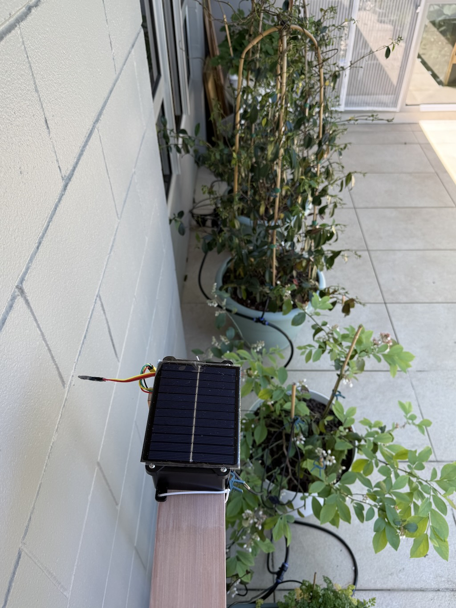
  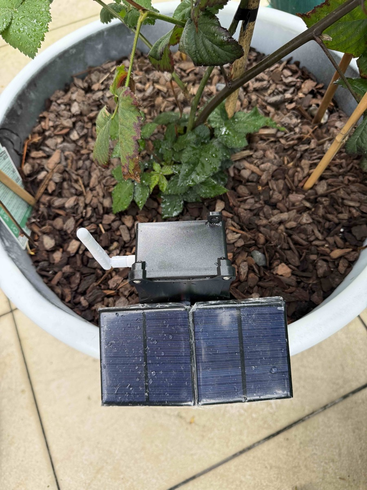
</p>

## The app

<table>
  <tr>
    <td align="center">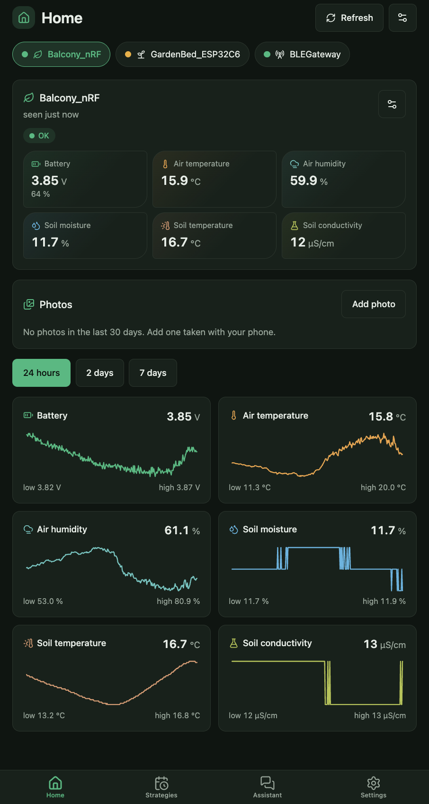<br><em>Readings</em></td>
    <td align="center">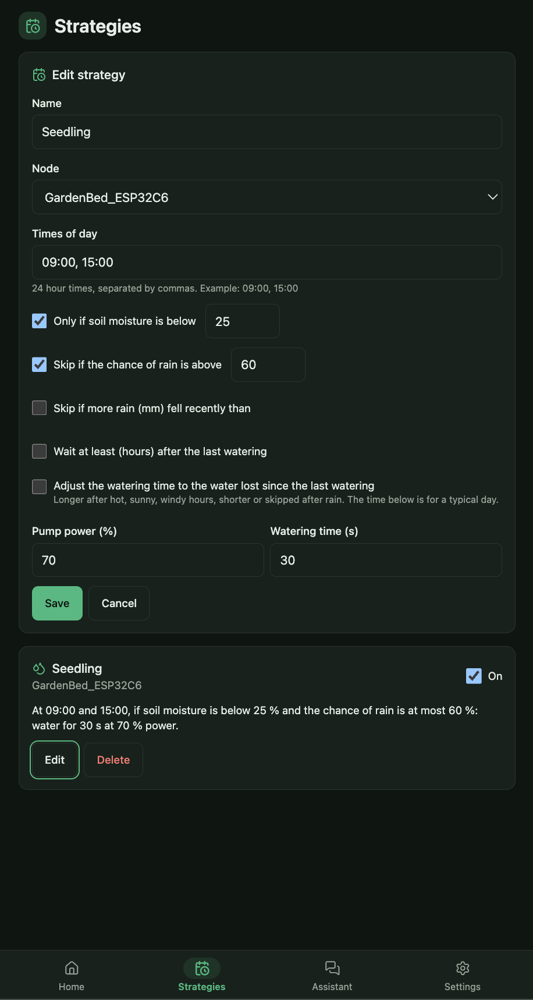<br><em>Strategies</em></td>
    <td align="center">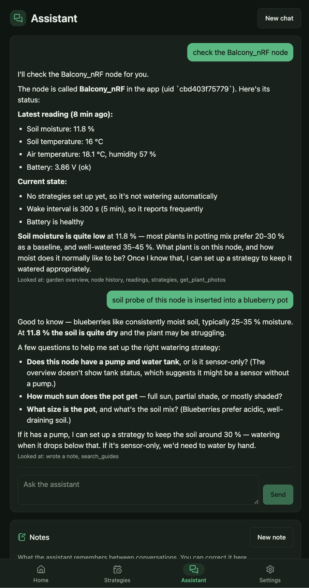<br><em>Assistant</em></td>
    <td align="center">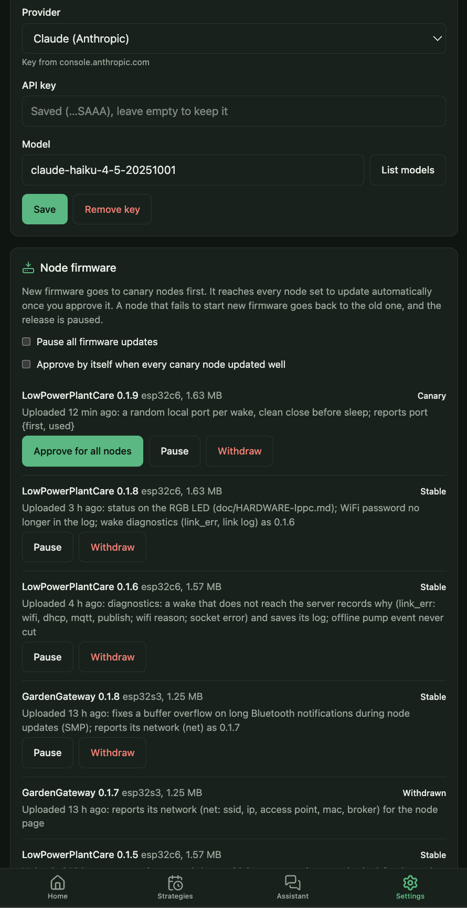<br><em>Firmware releases</em></td>
  </tr>
  <tr>
    <td align="center" colspan="2">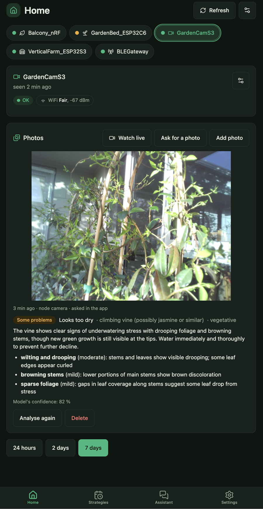<br><em>Camera node: photo and vision health report</em></td>
    <td align="center" colspan="2">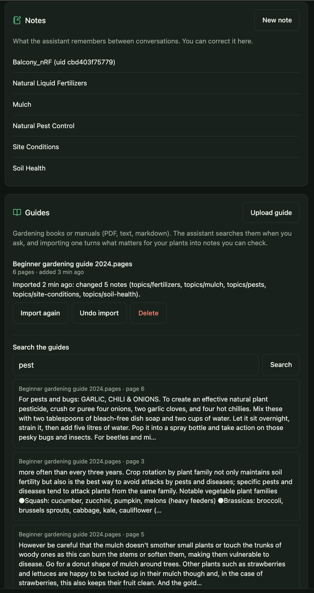<br><em>LLM wiki notes and guide search (RAG)</em></td>
  </tr>
  <tr>
    <td align="center" colspan="2">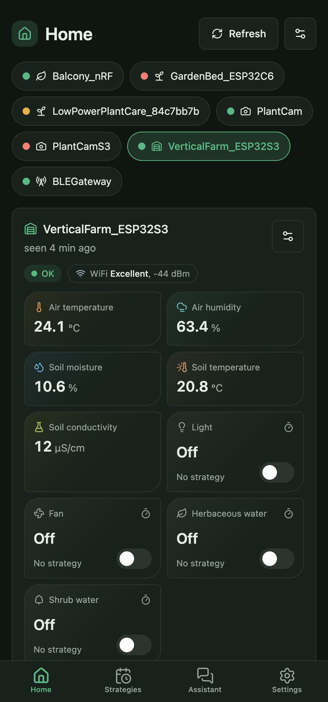<br><em>Vertical farm: readings and switchable outputs</em></td>
    <td align="center" colspan="2">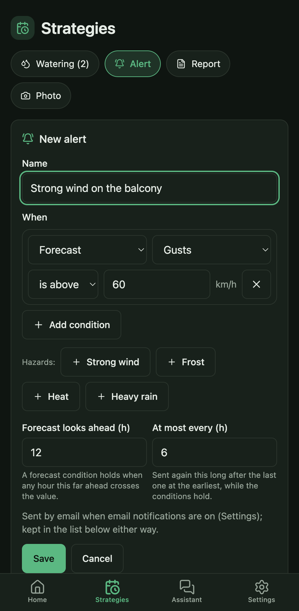<br><em>Alert strategy: forecast conditions and cooldown</em></td>
  </tr>
</table>

## How it works

```
 App (web / iOS) ──HTTP──► Server (Python, home VM) ◄──MQTT──┬── lppc watering node (ESP32-C6, battery)
       │                    ├─ strategies + weather          ├── vfarm controller (ESP32-S3, mains)
       └──BLE setup──►      ├─ assistant (LLM, MCP)          ├── plantcam (ESP32, camera)
                            ├─ firmware releases             └── gateway (ESP32-S3) ──BLE──► nRF52840 sensors
                            └─ SQLite
```

A battery node wakes, reads its soil probe (RS485 Modbus) and SHT31, reports, and waits 4 s for the server's answer: water or not, how long to sleep, and a copy of its strategies for when the server is down. A strategy fires at set times when its conditions hold: readings from any node (soil, air, battery), rain forecast, recent rain, gap since the last watering, and water lost to evaporation (Open-Meteo ET0 corrected by the node's own temperature). Alert and report strategies use the same conditions to send email.

## The assistant

A language model (Claude by default; OpenAI, Gemini, Ollama and others through adapters) with tools over the garden: per-day history with the moisture rise after each watering, weather, strategies, watering log, photo health reports. The same tools are served over MCP for Claude Code, with a separate MCP endpoint for a firmware developer agent.

**Memory.** The model has none of its own, so the system gives it two kinds:

- **LLM wiki**: markdown notes it writes and reads between conversations (`plants/blueberry`, `nodes/<uid>`, `lessons`): which plant each node waters, how fast a pot dries, what a watering does. The note index is in every request; the gardener can read and correct every note.
- **RAG over guides**: uploaded gardening books, indexed page by page in SQLite FTS5. Answers cite guide and page. A background job can merge a guide into the wiki, with citations and undo. No embeddings, so it works with any provider, including a local model.

## Guardrails

The design rule: **the LLM advises, plain code decides, a person approves.**

| Layer | Guardrail |
|---|---|
| Assistant | Propose only: every strategy change, wake interval or extra watering waits for the gardener's approval. Limits enforced in code, not the prompt: interval 5 min – 24 h, extra watering ≤ 60 s and ≤ 3 per node per day, ≤ 20 pending proposals, approved waterings expire after 6 h. A strategy edited since the proposal is not overwritten. |
| Prompt injection | Guide text, notes from guides and photos are treated as material, never instructions. The guide import job only has the two note tools. |
| Decisions | The LLM is never in the node's 4 s answer; a deterministic decision function is. A missing or stale reading (older than 3 h) stops a watering instead of guessing. Watering time from the water balance is capped at 0.25–2× and 120 s; farm water runs last at most 1800 s and are never left "on". |
| Node | Waters only on a server command or its offline schedule, through one queue that checks battery and water level. A 100 ms pump guard (water switch, battery sag) and a cycle watchdog that forces the pump off and the node to sleep. Critical battery sleeps before WiFi starts. |
| Firmware | Signed images (ECDSA / RSA, MCUboot on nRF). Offered only to healthy nodes, outside a watering window. A new image boots as a test and must reach the server or the bootloader rolls back; a rollback pauses the release. Canary first, stable only after the gardener approves, then a 24 h health watch. |
| Access | API token for the app and MCP; MCP refuses browser origins. LLM API keys are never sent back to the client. Alerts have a cooldown so one problem is one email. |

## Hardware

<table>
  <tr>
    <td align="center">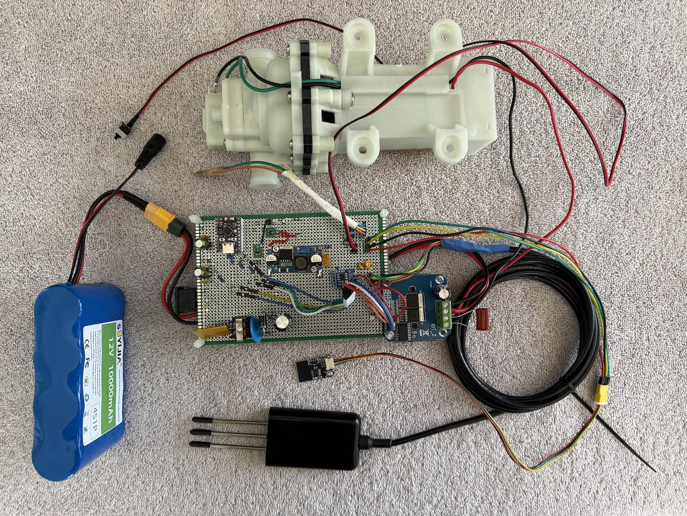<br><em>Watering node: ESP32-C6, 12 V pump on a BTS7960, switched sensor rail</em></td>
    <td align="center">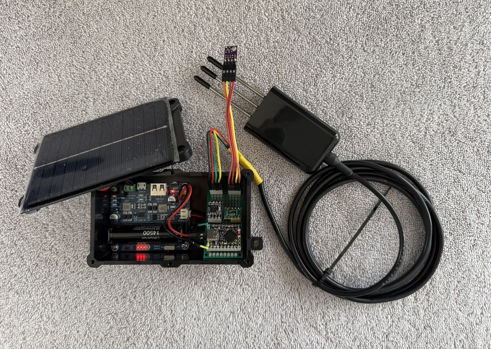<br><em>Sensor node: nRF52840 (Zephyr, MCUboot), solar Li-ion, BLE only</em></td>
  </tr>
  <tr>
    <td align="center">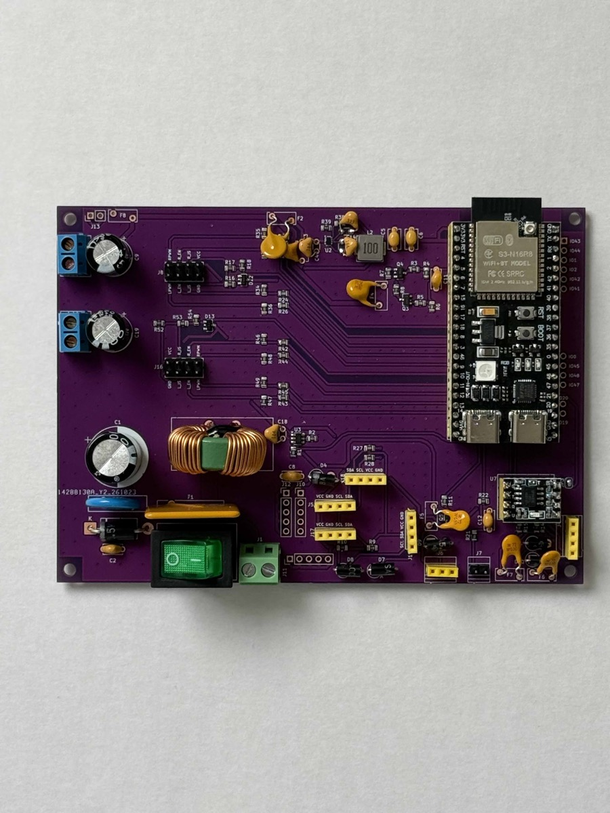<br><em>Watering node PCB v6: ESP32-S3, two pump drivers, 140 × 100 mm</em></td>
    <td align="center">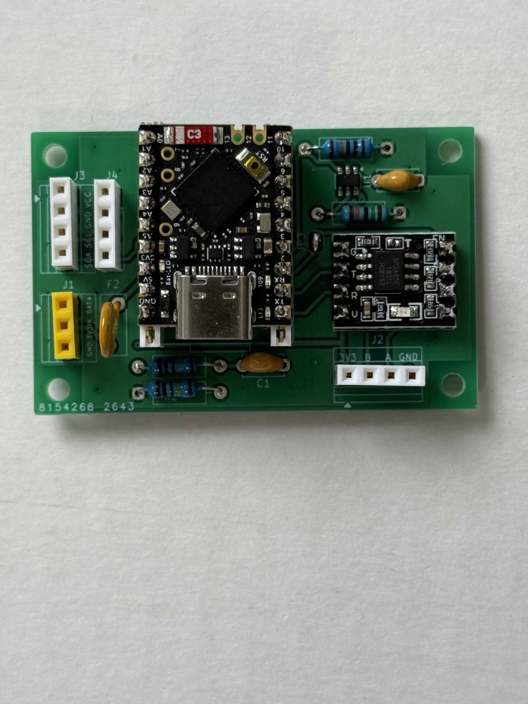<br><em>Sensor node carrier PCB: nRF52840, current-limited sensor rail, 55 × 35 mm</em></td>
  </tr>
  <tr>
    <td align="center">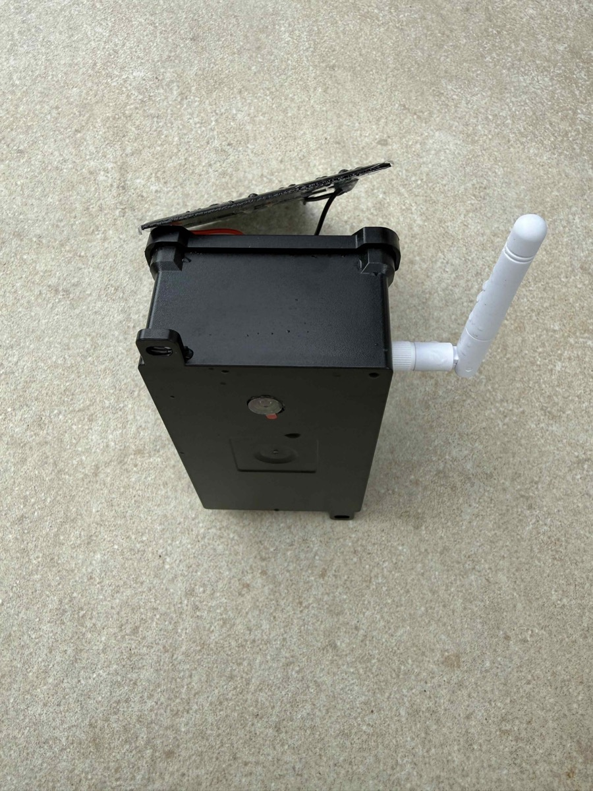<br><em>Camera node: ESP32-S3 camera, solar, in its case</em></td>
    <td align="center">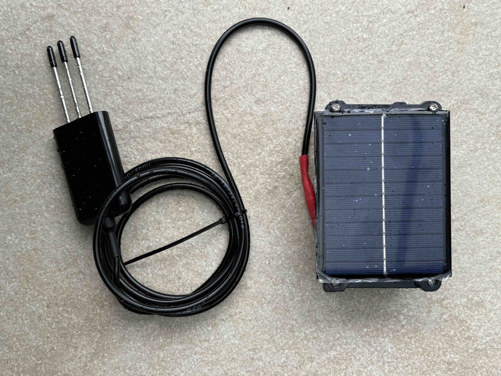<br><em>Sensor node, closed: solar lid and soil probe</em></td>
  </tr>
  <tr>
    <td align="center" colspan="2">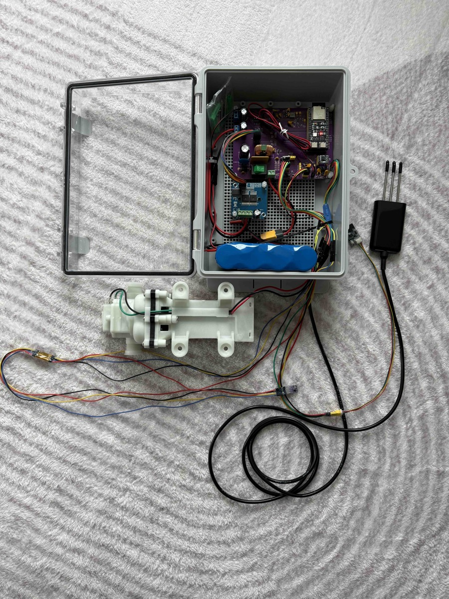<br><em>Outdoor enclosure demo: watering node v6 board, battery, pump and probe</em></td>
  </tr>
  <tr>
    <td align="center">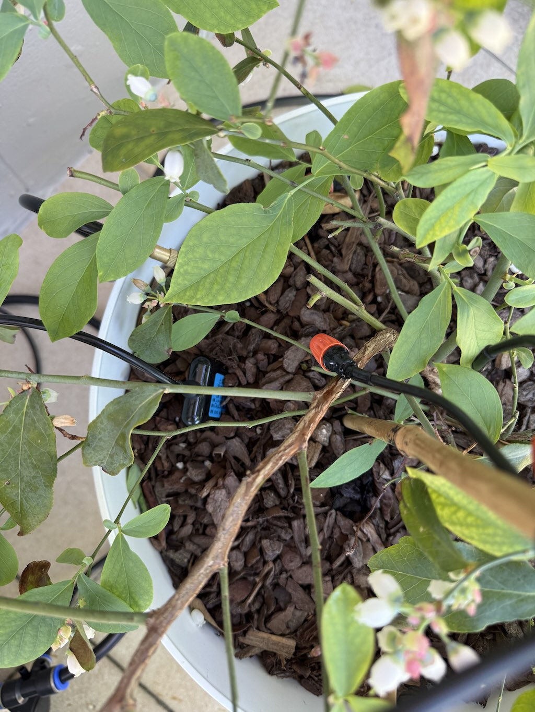<br><em>Probe and drip emitter in the blueberry pot</em></td>
    <td align="center">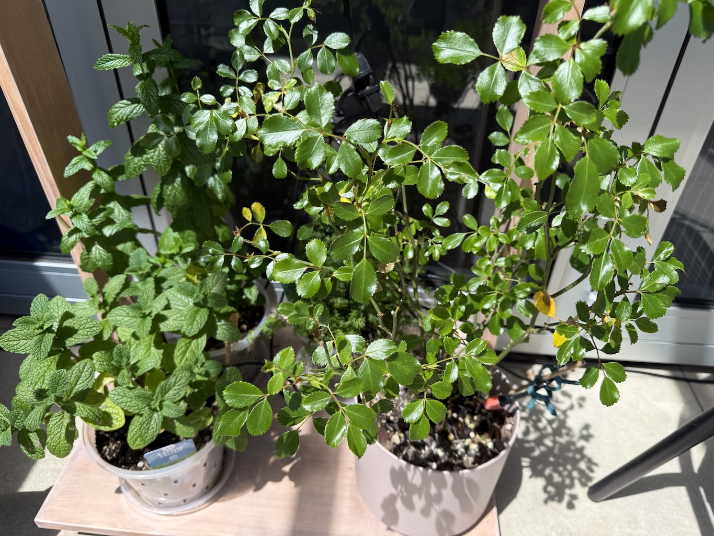<br><em>Balcony pots on the drip line</em></td>
  </tr>
</table>

Both PCBs are KiCad boards generated from Python scripts: parts, nets and tracks are placed by script, the rest routed by a small rule-aware grid router.

## Tests

Server 292 (pytest), client 81 (Vitest), firmware 35 host tests of the hardware-free logic (offline backlog, schedule, clock, battery, soil probe), plus a clean build of every firmware app.

## Repository layout

```
code/                    # symlinks to the private product repos (available on request)
├── GardenCareServer/    # Python 3.12, uv, aiohttp, amqtt, SQLite
├── GardenCareClient/    # Vite, React, TypeScript, Tailwind, Capacitor
└── GardenCareFirmware/  # ESP-IDF 5.5 apps (lppc, vfarm, plantcam, gateway) + Zephyr app (nrfsensor), KiCad
```

## Status

In daily use on a balcony in Auckland: the nRF sensor node, the vertical farm, the server on a home VM, and the web and iOS app. Both PCBs are fabricated; the watering node's v6 board is in bring-up.
